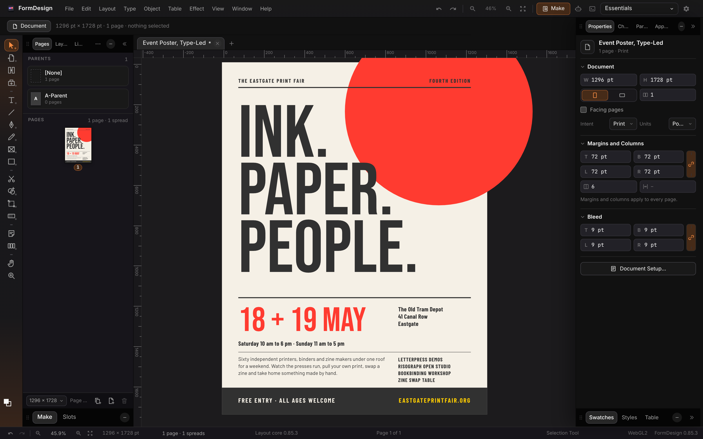
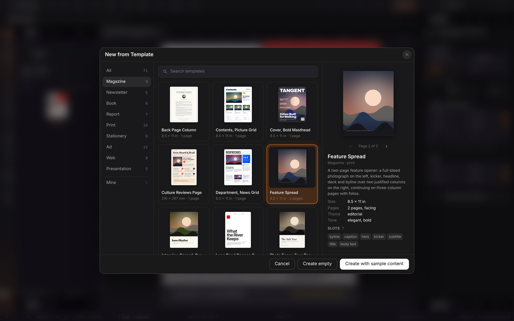
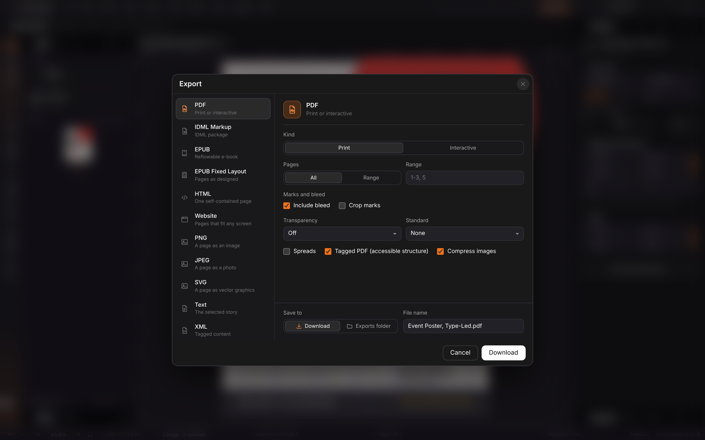

<p align="center">
  
</p>

<h1 align="center">FormDesign</h1>

<p align="center">
  <b>Page layout and publishing; magazines, books, reports, print and websites on its own Rust layout engine.</b><br>
  Spreads, threaded stories, styles, tables, vector drawing and templates,<br>
  with an MCP server for agents. Local-first, no account.
</p>

<p align="center">
  
  
  
  
  
  
</p>

<p align="center">
  <a href="https://formdesign.formai.studio/"><b>Download FormDesign on formai.studio</b></a> ·
  <a href="#run-it-from-source">Run it from source</a>
</p>

<br>

<p align="center">
  
  <br>
  <sub>The "Ink. Paper. People." poster template open in the editor, with the Pages panel and Properties visible.</sub>
</p>

<p align="center">
  <a href="#features">Features</a> · <a href="#everything-in-the-box">In the box</a> · <a href="#built-for-agents">Agents</a> · <a href="#under-the-hood">Under the hood</a> · <a href="#download">Download</a> · <a href="#run-it-from-source">Run from source</a>
</p>

<br>

<table>
  <tr>
    <td width="25%" valign="top"><h3>Own layout core</h3>A Rust core with its own paragraph composer, spreads, parent pages, threaded stories, footnotes and tables.</td>
    <td width="25%" valign="top"><h3>Templates that fill</h3>71 slotted templates; drop in Markdown, Word, PDFs and images with a brief and Make lays them out.</td>
    <td width="25%" valign="top"><h3>Print and web</h3>Export PDF, IDML, EPUB, HTML, PNG, JPEG and SVG, or publish a responsive multi-page website.</td>
    <td width="25%" valign="top"><h3>Agent-ready</h3>The same engine from the window, the CLI and an MCP server with 38 tools.</td>
  </tr>
</table>

<br>

## Features

<table>
  <tr>
    <td width="50%" valign="top">
      
      <br><sub>A headline frame selected, with its Properties on the right.</sub>
      <h3>Inspect and edit anything</h3>
      Transform, appearance, character and paragraph controls follow the selection. Styles, swatches and tables sit in the same column.
    </td>
    <td width="50%" valign="top">
      
      <br><sub>New from Template, filtered to magazines.</sub>
      <h3>71 templates</h3>
      Magazine, newsletter, book, report, print, stationery, ad, web and presentation, each re-skinned by a brand kit.
    </td>
  </tr>
  <tr>
    <td width="50%" valign="top">
      
      <br><sub>The Export dialog, with PDF print options.</sub>
      <h3>Export what the job needs</h3>
      Bleed, crop marks, transparency flattening, PDF standards and tagged PDF, or a website your readers open on a phone.
    </td>
    <td width="50%" valign="top">
      <h3>The Make pass</h3>
      Intake reads your files and brief, ranks templates, fills the slots, threads the article across pages and reports what is still sample text.
    </td>
  </tr>
</table>

## Everything in the box

<table>
  <tr>
    <td width="33%" valign="top"><h4>394 layout commands</h4>Spreads and parent pages · Threaded stories · Styles · Tables · Footnotes · Books · Track changes · Preflight · Find/Change · Libraries</td>
    <td width="33%" valign="top"><h4>41 tools</h4>Selection · Type · Pen · Shape Builder · Curvature · Knife · Gradient mesh · Artboards · Hand · Zoom</td>
    <td width="33%" valign="top"><h4>Formats</h4>Opens: Markdown, Word, RTF, HTML, CSV, spreadsheets, PDF, images · Saves: PDF, IDML, EPUB, HTML, PNG, JPEG, SVG, website</td>
  </tr>
</table>

## Built for agents

The window, the CLI and the MCP server drive the same engine, and the MCP server exposes 38 tools and five task prompts.

```sh
./formdesign make article.md photo.jpg --brief "Square ad for Northlight" --out ad.png   # intake, template, fill, export
./formdesign templates                       # list the 71 templates
./formdesign tool preview '{"page": 1}'      # call any MCP tool from a shell
./formdesign cli list                        # the shared command catalogue; run any command by id
./formdesign mcp                             # MCP server on stdio for Claude Code, Codex and Cursor
./formdesign mcpb build .                    # the same server as a Claude Desktop extension (.mcpb)
```

`.mcp.json`, `.codex/config.toml` and `.cursor/mcp.json` are already wired in this repo. `./formdesign agents install` registers it for your account. See [`AGENTS.md`](AGENTS.md). In the window, the terminal dock (Window > Show Terminal) holds shell tabs, Claude Code tabs that run your own `claude` with FormDesign's tools attached, and Chat with Claude; Window > Agent Connect decides what outside agents may do.

## Under the hood

- **Layout core:** a Rust workspace (`formdesign-core` over model, text, render, engine, interchange and gpu crates) talking JSON lines to the engine.
- **Engine:** FastAPI service with intake, templates, the Make pass, MCP, and the window socket at `/api/ws`.
- **Window:** vanilla TypeScript and Vite, tiled rendering of the core with overlays, in 26 languages.
- **Desktop:** Tauri 2 shell with the engine and the core as sidecars.
- **Tested:** 66 backend test functions (exports, templates, Make, MCP, consent, sockets, boot) and a window test suite.

## Download

| Platform | Download | Release |
|---|---|---|
| macOS | [Download FormDesign for macOS](https://formai.studio/get/formdesign/macos) | [FormDesign releases on FormCompiler](https://github.com/nodemode-dev/formcompiler/releases?q=formdesign-v&expanded=true) |
| Windows | [Download FormDesign for Windows](https://formai.studio/get/formdesign/windows) | [FormDesign releases on FormCompiler](https://github.com/nodemode-dev/formcompiler/releases?q=formdesign-v&expanded=true) |
| Linux | [Download FormDesign for Linux](https://formai.studio/get/formdesign/linux) | [FormDesign releases on FormCompiler](https://github.com/nodemode-dev/formcompiler/releases?q=formdesign-v&expanded=true) |

All FormDesign builds are compiled and released from [FormCompiler](https://github.com/nodemode-dev/formcompiler); this repo holds the source.

## Demo

[`demo/index.html`](demo/index.html) is an offline demo that opens from `file://` or any static server and shows the real FormDesign window on "The Island Press", a three-page magazine feature in threaded columns with a drop cap, a pull quote and paragraph styles: its pages and spreads, page navigation, zoom, menus, panels and workspaces. FormDesign's layout core is native code that does not run in a browser, so the page replays engine answers recorded from the real engine for this demo (document state, layout, panels' data and page pictures at 100% and 200%); editing, saving, export, Make and the assistant answer that they need the FormDesign engine. See [`demo/README.md`](demo/README.md). Two more pages of the same window link to each other and to it from the status bar:

- [`demos/event/index.html`](demos/event/index.html): an event poster, "Quay Lights", made from a short brief. See [`demos/event/README.md`](demos/event/README.md).
- [`demos/report/index.html`](demos/report/index.html): an annual review, "Harbour Trust Annual Review", laid out from one Markdown file. See [`demos/report/README.md`](demos/report/README.md).

The same three demos open inside the app from Home, from Help > Demos, or with the `ui.demo.magazine`, `ui.demo.event` and `ui.demo.report` commands, each as a new document.

## Run it from source

Prefer it in your browser, or want to contribute? Run the web UI straight from this repo.

**Requires:** Node 20.19 or newer, Python 3.12 or newer, Rust stable (for the layout core), git.

```sh
git clone git@github.com:nodemode-dev/formdesign.git
cd formdesign
./formdesign install     # engine venv, layout core, font library, frontend (Windows: formdesign.bat)
./formdesign boot        # web UI at http://localhost:5196, engine on http://127.0.0.1:8196
```

The first `install` compiles the layout core, which takes several minutes. `./formdesign doctor` checks the toolchain and ports. `./formdesign desktop dev` opens the desktop window instead; `./build_app` bundles it. Settings live in `backend/.env` (see `backend/.env.example`).

> [!IMPORTANT]
> **Status:** active. Opening .indd files, stock photo search, DWG drawings and .ai or PSD artwork are not supported; work on existing PDFs belongs to FormPDF.

**Contributing:** branch from `main`, keep changes to source here, and leave packaging and releases to FormCompiler. See [`.docs/BRANCHING.md`](.docs/BRANCHING.md) and [`AGENTS.md`](AGENTS.md).

Repository: `native/` (Rust layout core), `backend/` (FastAPI engine), `frontend/` (Vite window), `src-tauri/` (desktop shell), `setup/` (scripts), `docs/` (manual, template format).

Docs: [`.docs/wiki`](.docs/wiki) · Agents: [`CLAUDE.md`](CLAUDE.md), [`AGENTS.md`](AGENTS.md) · Contributing: [`.docs/BRANCHING.md`](.docs/BRANCHING.md)

<br>

---

## Maintainers

| Maintainer | Role |
|---|---|
| [@nodemode-ai](https://github.com/nodemode-ai) | Owner |
| [@gbarnai](https://github.com/gbarnai) | Co-owner |

Code owners are set in [`.github/CODEOWNERS`](.github/CODEOWNERS).

## License

FormDesign is licensed under the Apache License 2.0 ([`LICENSE`](LICENSE), SPDX `Apache-2.0`). Copyright 2026 NodeAgentc, Inc. Third-party notices: [`NOTICE.md`](NOTICE.md).

<sub>FormDesign names file formats by their extension and no other application. Product names a person may associate with those formats are the trademarks of their owners; FormDesign is not affiliated with or endorsed by any of them.</sub>
